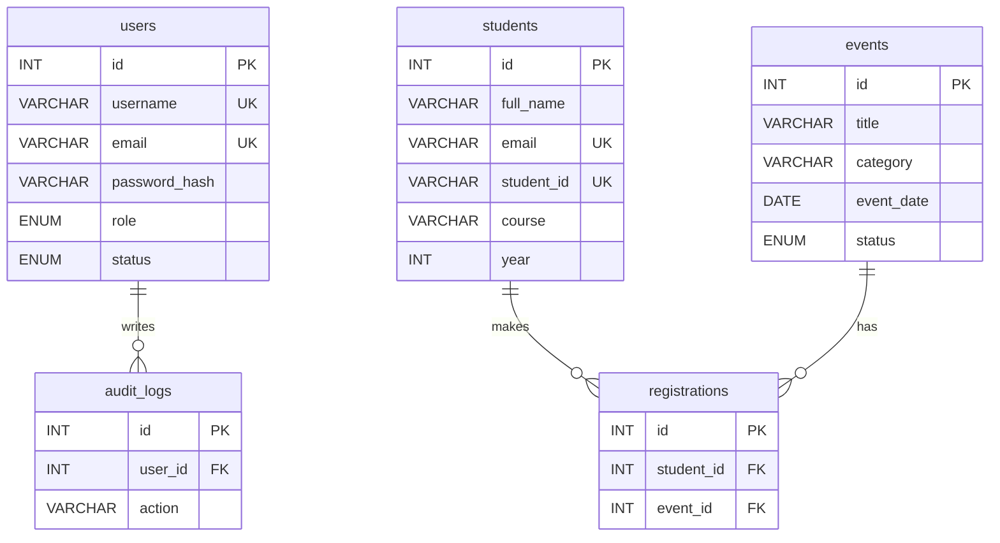

# Practical 8 — MySQL Schema Design, ER Model, PDO Connectivity, and Prepared Statements

## Purpose

Design the StudentHub database (`studenthub_p8`) with normalized tables for
users, students, events, registrations and audit logs. Connect to it from PHP
using **MySQLi** (`db.php`) and **PDO with prepared statements** (`db_pdo.php`),
plus a stored procedure (`GetEventRegistrationCount`). Verify everything on the
`test_connection.php` page.

## Setup Steps

1. Start **Apache** and **MySQL** in the XAMPP Control Panel.
2. Open phpMyAdmin at `http://localhost/phpmyadmin`.
3. Click the **Import** tab, choose `PRACTICAL 8/database.sql`, and click **Go**.
   - This creates the `studenthub_p8` database, all tables, seed data, and the
     stored procedure.
4. Copy the `PRACTICAL 8` folder into your XAMPP web folder (`htdocs`), if it is
   not there already.
5. Open the connection test page in your browser:

   `http://localhost/.../"PRACTICAL 8"/test_connection.php`

   (Replace `...` with your actual folder path under `htdocs`.)
6. You should see **MySQLi OK** and **PDO OK**, plus row counts for each table.

## Login Credentials (seeded users)

| Username | Password    | Role    |
|----------|-------------|---------|
| admin    | Admin@123   | admin   |
| student  | Student@123 | student |

Passwords are stored as bcrypt hashes (cost 10) in the `users` table.

## ER Diagram

## Viva Q&A

**Q1. Why is this schema normalized?**
Each fact is stored in only one place: student details live in `students`,
event details in `events`, and `registrations` stores only the two IDs that
link them (plus its own key). This avoids repeated data, so an update (for
example a venue change) happens in one row and can never disagree with a copy
elsewhere.

**Q2. Why use prepared statements instead of joining values into SQL text?**
A prepared statement sends the SQL code and the user values separately, so the
database never mistakes a value for a command. This blocks SQL injection even
if a visitor types quotes or SQL keywords into a field.

**Q3. What is the purpose of the foreign keys?**
Foreign keys keep the links between tables honest: a registration cannot point
to a student or event that does not exist. `ON DELETE CASCADE` removes a
student's registrations automatically if the student is deleted, and
`ON DELETE SET NULL` keeps audit history while clearing the deleted user's ID.
